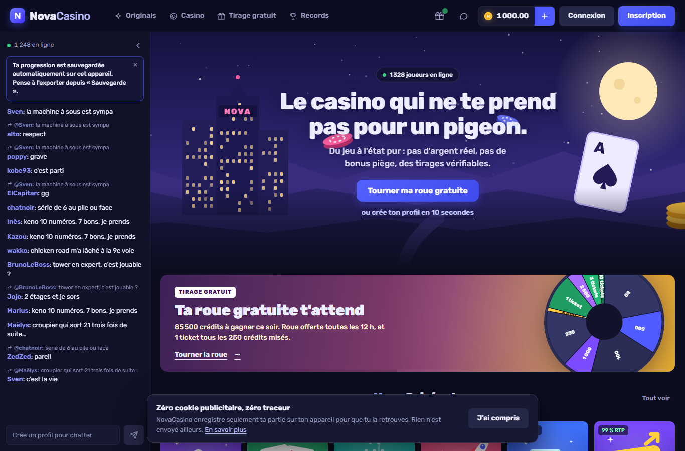
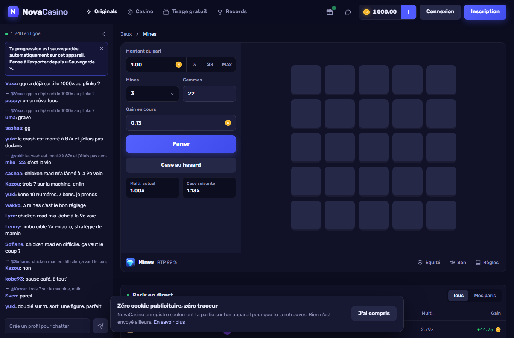
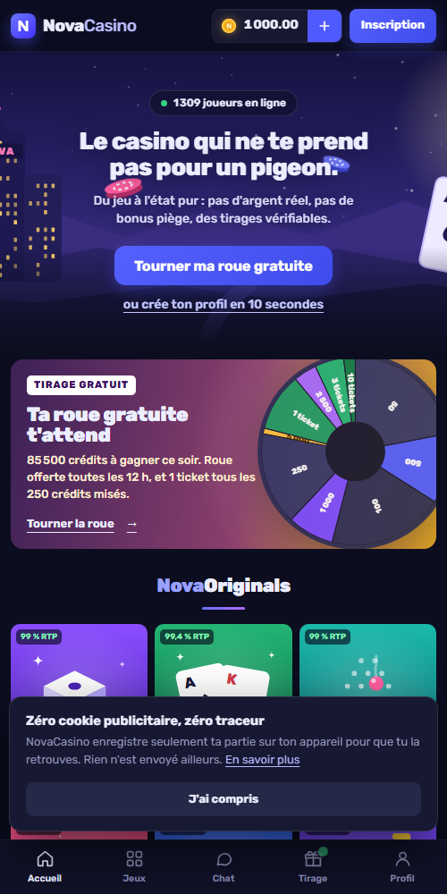
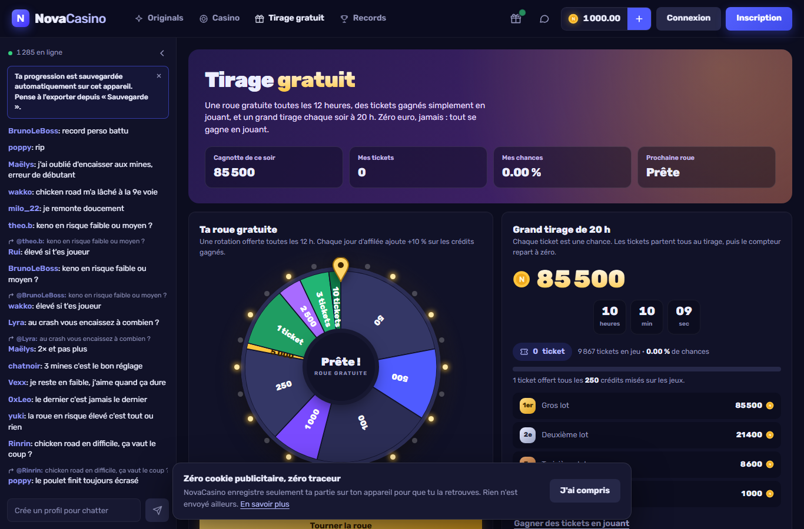

# NovaCasino

**Le casino qui ne te prend pas pour un pigeon.** 13 jeux de casino gratuits, en crédits fictifs, jouables sur ordinateur et sur téléphone, sans inscription ni argent réel.

> ⚠️ **Crédits fictifs uniquement.** Les crédits n'ont aucune valeur : ils ne peuvent être ni achetés, ni échangés, ni retirés. NovaCasino n'est pas un opérateur de jeux d'argent. Réservé aux 18 ans et plus.

🌐 Site : [novacasino.eu](https://novacasino.eu) · 🗂️ Suivi du projet : [Trello](https://trello.com/b/qW8xcRsD/novacasino)



## Les jeux

| NovaOriginals | | Tables & machine |
|---|---|---|
| **Dice** : cible et chance en % | **Keno** : 10 numéros tirés sur 40 | **Blackjack** : sabot 6 jeux, 3:2, doubler, séparer |
| **Limbo** : multiplicateur cible | **Coin Flip** : série de lancers à 1,98× | **Roulette** : européenne, un seul zéro |
| **Crash** : courbe et encaissement | **Wheel** : roue segmentée, 3 risques | **Nova Fruits** : 3 rouleaux, 5 lignes |
| **Plinko** : 8, 12 ou 16 rangées | **Tower** : 8 étages, 5 difficultés | |
| **Mines** : 25 cases, 1 à 24 mines | **Chicken Road** : traverser voie par voie | |

Retour théorique : 99 % sur les Originals, 99,4 % au Blackjack, 97,3 % à la Roulette, 96,5 % sur Nova Fruits.

| Ordinateur | Téléphone |
|---|---|
|  |  |

## Fonctionnalités

- **Tirage gratuit** : roue offerte toutes les 12 h, tickets gagnés en jouant (1 ticket par 250 crédits misés), grand tirage chaque soir à 20 h.
- **Profils locaux** : plusieurs profils par appareil, avatar à initiales, sans e-mail ni mot de passe.
- **Sauvegarde** : automatique dans le navigateur, exportable en un code (`NOVA1-…`) ou en fichier pour passer du PC au téléphone.
- **Partie interrompue** : une partie en cours est réglée ou remboursée au prochain chargement, jamais perdue bêtement.
- **Mode automatique** sur les jeux compatibles, chat et paris en direct simulés, page Records.
- **Mobile** : barre d'onglets, jeux au-dessus des commandes, installable sur l'écran d'accueil.
- **Confiance** : aucune ressource tierce, police hébergée, bandeau cookies conforme CNIL, pages RGPD / CGU / mentions légales, page 404, Lighthouse 100 en accessibilité, bonnes pratiques et SEO.



## Équité vérifiable

Chaque résultat sort d'un générateur déterministe (`cyrb128` + `sfc32`) alimenté par trois valeurs : une **graine serveur** (cachée, dont l'empreinte est publiée à l'avance), une **graine client** modifiable, et un **nonce** incrémenté à chaque pari. Depuis « Équité vérifiable », on peut changer de graines : l'ancienne graine serveur est alors révélée, ce qui permet de vérifier qu'elle n'a pas changé pendant la partie.

## Lancer le projet

```bash
npm install
npm run build     # construit le site dans dist/ et vérifie les liens
npm run serve     # http://localhost:5178
```

Réglages (domaine, éditeur, hébergeur, analytics) : `site.config.json`.

## Structure

```
src/
  core/      état, sauvegarde, équité, routeur, écran de jeu, tirage, consentement
  games/     un fichier par jeu
  styles/    feuilles de style
  pages/     pages légales et 404
  static/    police, icônes, image de partage
tools/       construction (esbuild), génération des images
dist/        site prêt à héberger
```

## Déploiement

Le workflow `.github/workflows/pages.yml` construit et publie `dist/` sur GitHub Pages à chaque push sur `main`. Le fichier `CNAME` pointe sur `novacasino.eu` ; les enregistrements DNS se configurent chez IONOS.
